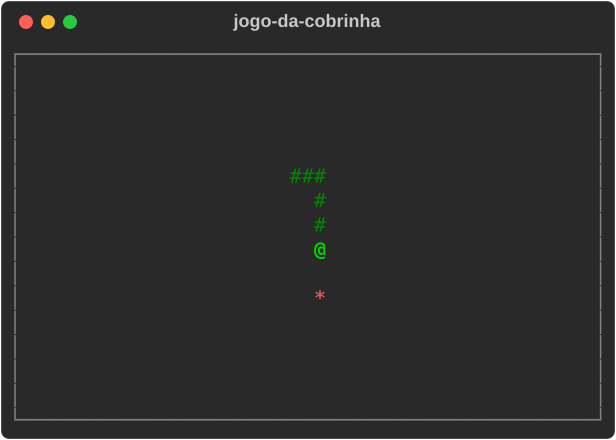

# 🐍 Jogo da Cobrinha em Python | Exercício de Lógica de Programação


[](https://github.com/ryanvmorais/python-jogo-da-cobrinha/actions/workflows/ci.yml)


Este repositório contém o clássico **Jogo da Cobrinha (Snake Game) em Python**, projetado como material de estudo para desenvolvedores iniciantes. O foco principal é a aplicação de **lógica de movimento**, manipulação de listas dinâmicas e o uso da biblioteca `curses` para interfaces de terminal.

### 🎯 Objetivo do Projeto:

Demonstrar a aplicação de **estruturas de dados (listas)**, **controle de eventos em tempo real** e **modularização de funções**. É um projeto prático ideal para estudantes que desejam entender como jogos baseados em coordenadas e ciclos de atualização (*game loops*) funcionam.

---

### 📚 O que você vai aprender com este projeto?

Este exercício foi estruturado para consolidar conceitos essenciais de algoritmos:

- **Manipulação de Listas:** uso de `insert` e `pop` para simular o movimento e o crescimento do corpo da cobra.
- **Controle de Fluxo e Tempo:** gerenciamento da velocidade do jogo e captura de teclas sem interromper a execução (`timeout`).
- **Lógica de Coordenadas:** como gerenciar posições `[y, x]` dentro de um plano cartesiano delimitado por bordas.
- **Biblioteca Curses:** manipulação avançada do terminal para criar janelas, bordas e desenhar caracteres em posições específicas.
- **Modularização:** organização do código em funções com responsabilidades únicas (S.O.L.I.D. para iniciantes).

---

### 🧠 Guia de Implementação (A Lógica por trás do Código):

Para quem está começando, o maior desafio não é a sintaxe, mas a **montagem do raciocínio**. Confira o passo a passo da construção deste jogo:

1. **Modelagem Dinâmica do Corpo:** a cobra não é um objeto único, mas uma **lista de coordenadas** `[[y, x], [y, x]]`. A "cabeça" é sempre o primeiro item (índice `0`), e o restante da lista forma o rastro que chamamos de corpo.
2. **A Matemática do Movimento:** em vez de "empurrar" cada gomo da cobra, usamos um truque lógico: em cada turno, calculamos e inserimos uma **nova cabeça** na direção escolhida. Se a cobra não comer nada, removemos o último item da lista (a cauda). Essa troca constante cria a ilusão de movimento.
3. **Detecção de Colisões:** o sistema monitora a coordenada da cabeça em tempo real. Se ela for igual aos limites da borda (`y <= 0` ou `x >= largura`) ou se coincidir com qualquer coordenada que já exista na lista do corpo, o jogo identifica o impacto e encerra a partida.
4. **Ecossistema e Alimentação:** utilizamos a biblioteca `random` para sortear posições para a fruta. Quando a cabeça ocupa a mesma posição da fruta, o sistema incrementa a pontuação e **não remove a cauda** naquele turno, resultando no crescimento natural da cobra.
5. **Prevenção de Movimento Oposto:** para evitar o "suicídio lógico", implementamos uma trava que impede a cobra de virar 180° instantaneamente (ex.: tentar ir para cima quando já está indo para baixo). O comando só é aceito se for uma curva lateral.
6. **O Coração do Jogo (Game Loop):** um loop `while True` coordena o tempo do jogo. Ele limpa a tela, desenha os atores (caracteres `ASCII`), processa a entrada do teclado e aguarda alguns milissegundos antes de repetir tudo, garantindo que o jogo não rode rápido demais para o olho humano.
7. **Abstração com Funções:** o código é dividido em funções especialistas (como `mover_cobra` e `verificar_colisoes`), facilitando a manutenção e permitindo que você entenda o papel de cada peça no funcionamento global do sistema.

---

### 🛠️ Tecnologias e Ferramentas:

Para garantir a melhor experiência de aprendizado, o projeto utiliza as seguintes tecnologias:

| Ferramenta | Descrição |
| :--- | :--- |
| **Python 3.12+** | Linguagem principal do projeto. |
| **curses** | Biblioteca padrão do Python para desenhar janelas, bordas e caracteres em posições específicas do terminal. No Windows, vem do pacote `windows-curses`. |
| **uv** | Gerenciador de dependências e ambientes virtuais: cria o ambiente, instala o `windows-curses` no Windows e roda o jogo com um único comando. |
| **Terminal** | Interface onde o jogo roda e recebe as teclas do jogador (CMD, PowerShell ou o terminal do VS Code/PyCharm). |

As ferramentas de qualidade (Ruff, Black, Mypy e Pytest) estão em [Qualidade e testes](#qualidade-e-testes). Para o porquê de cada escolha, veja [docs/stack.md](docs/stack.md).

---

### ⚙️ Como rodar o projeto localmente:

**Pré-requisitos:** [Python 3.12+](https://www.python.org/downloads/) e [uv](https://docs.astral.sh/uv/getting-started/installation/). Para conferir, rode `python --version` e `uv --version`.

1.  **Clone o repositório:**
    ```bash
    git clone https://github.com/ryanvmorais/python-jogo-da-cobrinha.git
    cd python-jogo-da-cobrinha
    ```
2.  **Execute o jogo:** no terminal do sistema (Prompt de Comando ou PowerShell), dentro da pasta do projeto, para uma melhor experiência visual. O `uv` cria o ambiente virtual e instala o `windows-curses` no Windows sozinho.
    ```bash
    uv run main.py
    ```
3.  **Prefere dois cliques? Use o atalho:** no Windows, abra o `iniciar_jogo.bat`; no Linux/macOS, execute o `iniciar_jogo.sh` no terminal. Os scripts detectam se você tem `uv` (preferido) ou `python`/`python3` instalado antes de iniciar a partida.

> ⚠️ **Nota:** sem o `uv`, `python main.py` funciona igual. No Windows, instale antes o `windows-curses` com `pip install windows-curses`; em Linux/macOS o `curses` já vem com o Python.

---

### Qualidade e testes

O projeto tem uma suíte de testes automatizados (`pytest`) e um portão de qualidade que roda no CI a cada push e a cada PR:

```bash
uv sync                 # instala as dependências de desenvolvimento
uv run ruff check .     # lint + ordem de imports
uv run black --check .  # formatação
uv run mypy             # checagem de tipos
uv run pytest           # testes
```

Para o mapa de cada tecnologia da stack (o que é, por que foi escolhida, o que estudar), veja [docs/stack.md](docs/stack.md). Para o comportamento esperado do jogo e o histórico de decisões, veja [specs/](specs/). Para o detalhamento de arquitetura e convenções, veja [CLAUDE.md](CLAUDE.md).

---

### 📋 Atividades para praticar (Desafios de Evolução):

Para exercitar o que aprendeu, tente modificar o código e implementar estas novas funcionalidades:

1. **🏆 Sistema de Recorde:** hoje a pontuação reinicia toda vez que o programa fecha. Crie uma "memória permanente": ao iniciar, o jogo lê o arquivo `recorde.txt`; se a pontuação da partida ultrapassar o valor lido, sobrescreva o arquivo com o novo recorde antes de encerrar.
   - **O Aprendizado:** manipular arquivos (`open`, `read`, `write`) para salvar dados no computador (`HD/SSD`) e fazer o recorde persistir mesmo depois de desligar a máquina.
2. **🍎 Frutas Especiais:** crie uma fruta "dourada" que aparece raramente e dá 5 pontos de uma vez.
   - **O Aprendizado:** usar o módulo `random` para eventos raros (probabilidade) e dar a um tipo de item uma regra própria sem duplicar a lógica de colisão.
3. **🔳 Atravessar Paredes:** altere a lógica de colisão para que, ao bater na borda direita, a cobra reapareça na borda esquerda.
   - **O Aprendizado:** trabalhar com os limites das coordenadas (por exemplo, com o operador `%`) e ver como uma regra do jogo vira uma condição no código.

---

### 🧭 Continue praticando:

Este projeto faz parte de uma trilha de estudos em Python. Depois deste, o próximo passo é sair do terminal e construir aplicações web com Django:

- **[Portfólio Dinâmico com Django](https://github.com/ryanvmorais/django-fullstack-portfolio):** segurança avançada (honeypot, rate limit, CSP) e otimização de consultas.
- **[Blog Culinário em Django](https://github.com/ryanvmorais/django-blog-culinario):** modelagem de domínio, autenticação, admin e segurança.

Veja todos os projetos e vídeos do canal em [aprenda-com-ryan-morais](https://github.com/ryanvmorais/aprenda-com-ryan-morais).

---

### 💡 Ficou com alguma dúvida ou tem sugestões?

Aprender algo novo tem seus desafios, mas estou aqui para caminharmos juntos! Se você encontrou algum erro, teve dificuldade em rodar o jogo ou pensou numa melhoria que tornaria este material ainda mais didático:

- **Abra uma [Issue](https://github.com/ryanvmorais/python-jogo-da-cobrinha/issues):** descreva sua dúvida ou sugestão. É a melhor forma de trocarmos conhecimento e ajudarmos outras pessoas que tenham a mesma dúvida.
- **Contribua com código:** quer propor uma melhoria? Veja o passo a passo no [CONTRIBUTING.md](CONTRIBUTING.md).
- **Me mande um e-mail:** se preferir algo mais privado, escreva para [**contato@ryanmorais.com.br**](mailto:contato@ryanmorais.com.br).

Ficarei muito feliz em ver seu progresso e receber seu feedback para melhorar cada vez mais nossos materiais de estudo! 🤝

---

### ⚖️ Licença

Este projeto está sob a **Licença MIT**. Isso significa que você pode usar, copiar e modificar o código à vontade, inclusive nos seus projetos. Para mais detalhes, consulte o arquivo [LICENSE](LICENSE).
